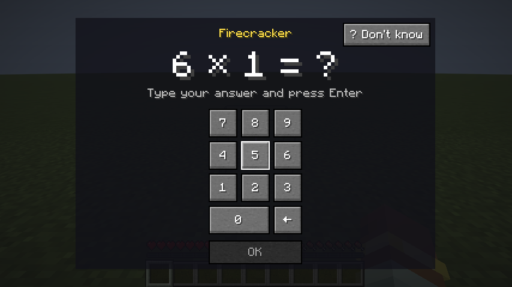
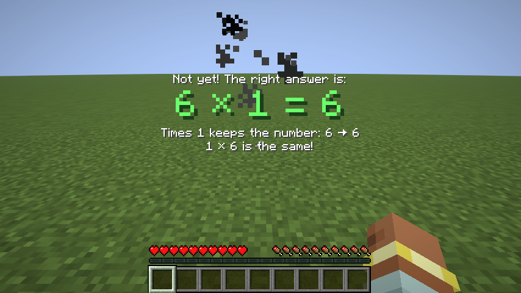
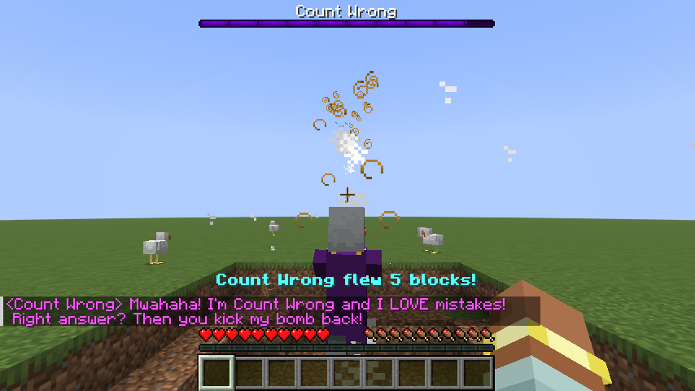
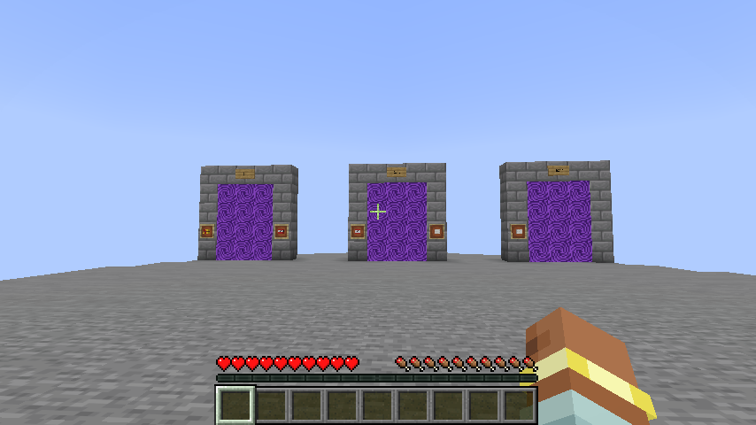
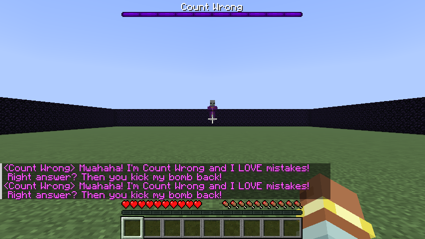
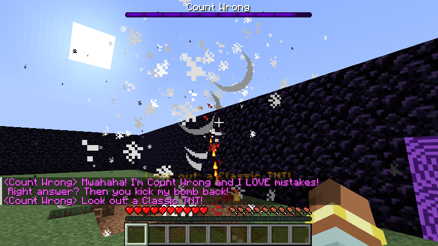
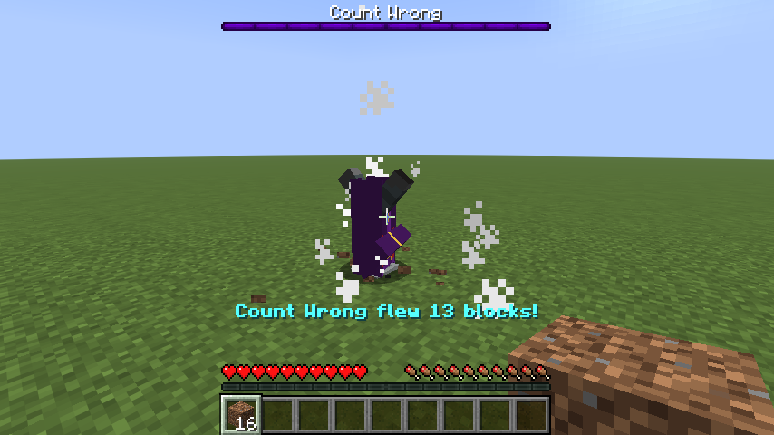
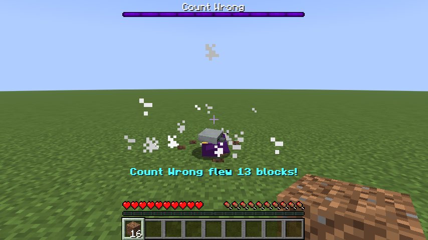
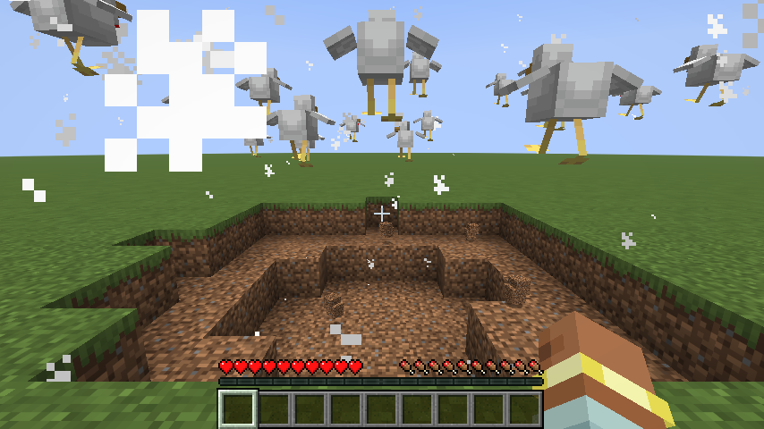

# TafelBoem 💥

A Minecraft Java Edition mod (Fabric, Minecraft 26.2) that helps kids practise the multiplication
tables 1–10 in a playful way: every fuse is a sum.

Right-click a bomb and you are rooted in place while a sum pops up. Answer correctly and you escape
the boom, or kick it back at the villain **Graaf Fout** and watch him get yeeted. Answer wrong and
the bomb goes off on you; you're free again straight away, and the correct fact shows big on your
screen while the game goes on. It comes back as a question soon after. On the medium and hard
levels a wrong answer also costs a heart or two, never the last one.

| Question | Correction after a miss | Graaf Fout gets yeeted |
|---|---|---|
|  |  |  |

The full design lives in
[`docs/superpowers/specs/2026-10-07-tafelboem-design.md`](docs/superpowers/specs/2026-10-07-tafelboem-design.md).

## Roadmap

The mod is delivered in small releases. Each one is play-tested with the kids and ends in a
go/no-go (see the spec):

| Release | Content | Status |
|---|---|---|
| **R0 "Graaf Fout komt!"** | Core question loop, 3 bombs, basic Graaf Fout (yeeted on every hit), LAN, answer log | ✅ playtest 1 done |
| **R0.1 "Beter mikken"** | Fixes from playtest 1: clearer question screen, correction on the HUD, distinct bombs, camera assist, a simple kick, more yeets, world setup, better stats, self-updating Prism instance | ✅ playtest 2 done |
| **R1 "Kies je level"** | TafelBoem world with a hub and a door per level, levels 1–3 with their own tables and bombs, arenas (random per level, replaceable by the kids' own), stars; from 1.0.2 hearts, food, music per level | ✅ published (1.0.x), playtest 3 to do |
| **R1.1 "Meer yeets"** | A flight plus a landing per hit (wall splat, head-first, pancake, running round, a landing per bomb), fast answers and streaks yeet Graaf Fout further with a record per kid, the counting Kippenbom | ✅ 1.1.x, playtest to do |
| Faster tests | Nothing new for the kids: the same tests, quicker to run | next, after R1.1 |
| R1.2 | Experiments: dodgeable bombs, Graaf Fout eats your mistake | backlog |
| R2 "Leren dat blijft" | Fact states, spaced practice, Tafelkaart, parent report, daily limit, "Kies je bom", leg-kick animation | backlog |
| R3 "Meer boem" | Bombs 4–9, craters, particle shows, lives, co-op rescue | backlog |
| R4 new villains | Tante Toverfout, Robo-Rekenaar 3000 | backlog |
| R5 endgame | Endless mode, hardcore | backlog |

Evaluations are recorded in [`docs/evaluations/`](docs/evaluations/).

## The TafelBoem world

Create a new world and set **World Type** to **TafelBoem**. It is an empty void world with no
monsters, and it starts with always day, no weather and keep inventory on. Game mode is not forced,
so the kids can also build there in creative.

| The hub | An arena (level 2) | Graaf Fout gets yeeted |
|---|---|---|
|  |  |  |

| Head-first | Pancake | Counting Kippenbom (3 groups) |
|---|---|---|
|  |  |  |

- **The hub.** You start on a stone platform facing three doors, one per level. A sign above each
  door says which level it is, and the bombs Graaf Fout throws there sit beside it in item frames.
  Builds on the hub's own platform are reset every time the world loads; builds beside it stay.
- **The levels.** Walk into a door to go to its arena. Level 1 asks the tables of 1, 2, 5 and 10,
  level 2 adds 3, 4 and 9, and level 3 asks all ten. About three seconds after you arrive, Graaf
  Fout appears and the fight starts. Anyone who walks through the same door while the fight runs
  joins it.
- **Stars.** A win is ★, a win with at most 2 wrong answers is ★★ and a win without a wrong answer
  is ★★★. Only typed wrong answers count: "?" and ESC don't. The best result per level counts. Stand
  within 3 blocks of a door in the hub to see your own stars for that level. Set `stars` to `false`
  in the config to hide them.
- **Music.** Each level's arena has its own track, over and over: Otherside on level 1, Pigstep on
  level 2 and "Boss" (the Ender Dragon fight) on level 3. Back in the hub the normal music returns.
  The Music slider must not be at 0. Set `arenaMusic` to `false` to keep the normal music.
- **Hearts.** In survival, a typed wrong answer costs 1 heart on level 2 and 2 hearts on level 3,
  never on level 1 and never the last half heart. "?" and ESC never cost hearts. Creative players
  can't be hurt. Set `wrongAnswerDamage` to `false` to switch it off.
- **Yeets and landings.** Every hit sends Graaf Fout on a flight (classic, bounce, helicopter,
  boomerang, tumble, and in an arena the wall splat) and then a landing: dizzy, head-first in the
  ground, a pancake, or running round in a panic. Each bomb has a landing of its own every other
  kick of that bomb: a Knalletje hurts his toe, a Gewone TNT leaves him black with soot, and a
  Kippenbom's chickens chase him. Set `yeetCatalogue` or `bombSignatures` to `false` to switch them off.
- **Further and further.** A fast answer (clearly faster than your own usual time for that sum) and
  right answers in a row yeet him further, and your yeet-o-meter says why, for example "(fast, 4 in
  a row!)". Only a typed wrong answer ends a streak; "?" doesn't. Beat your own farthest yeet and
  you see "New record!". Nobody else sees your reasons or records. Set `yeetBoost` or `yeetRecords`
  to `false` to switch them off.
- **The counting Kippenbom.** A right answer on a Kippenbom counts its chickens out as the sum: for
  3 × 4, 3 chickens fly out and each pops into 4 where it lands, so you see 3 groups of 4 standing
  together. They poof after 10 seconds. A wrong answer lets 1 chicken hop out at you. Set
  `countingKippenbom` to `false` for 12 flying chickens as in 1.0.
- **A win.** Everyone still in the arena gets 4 cooked chicken and their stars, and is back in the
  hub 5 seconds later. Eat to keep the hunger bar full: with a full bar, lost hearts come back by
  themselves (on Peaceful there is no hunger at all). Set `foodReward` to `false` to give 4
  Kippenbommen instead.
- **The exit door.** Every arena has one exit door, and you arrive 3 blocks in front of it. Walking
  through it takes you back to the hub without a reward, and the others play on. When the last kid
  has left, Graaf Fout poofs away.
- **Falling is safe.** Anyone who falls into the void, anywhere in the world, is put back without
  damage: at the arrival spot in a fight, otherwise in the hub.
- **Other worlds.** Every other world still works as before: the summon item starts the R0.1 fight
  with all tables, and `/tafelboem arena` still sets one up. In a TafelBoem world the summon item
  only says to use the doors. The R1.1 yeets, landings, boost and counting Kippenbom work there too;
  records are only kept in a TafelBoem world.

Each fight is written to `tafelboem/fights-<player>.jsonl` in the world folder, next to the answer
log. `/tafelboem stats` shows a line per level, for example "Medium: ★★☆, 3 of 4 won".

## Build your own arena

The kids can build their own hub and arenas in creative, in any world with cheats on, and save them
with vanilla structure blocks. The mod picks one of the arenas for a level at random, never the same
one twice in a row. It uses the plain arena it builds itself only when a level has none, or when all
of its arenas are skipped.

1. Build it. The door blocks, one per level and an exit, are in the **TafelBoem** creative tab.
2. Run `/give @s minecraft:structure_block`. Put one structure block in each of two opposite
   corners and set them to **Corner**. Put a third one beside the build and set it to **Save**.
   Give all three the same name: `tafelboem:level_<n>/<name>` for an arena, for example
   `tafelboem:level_2/kasteel`, or `tafelboem:hub` for the hub.
3. Press **Detect** on the Save block, then **Save**.
4. Minecraft writes `saves/<world>/generated/tafelboem/structure/<name>.nbt`. In a TafelBoem world
   the arena is used from the next time a kid walks into that level. To ship it to every PC, copy
   the `.nbt` file into `src/main/resources/data/tafelboem/structure/` and publish a new version.

**Rules for an arena:**
- At most 48 × 48 × 48, which is what one structure block can save.
- Open sky over the play area. Under a roof Graaf Fout would hover on the roof.
- Exactly one exit door, placed where the kids should come in. They arrive 3 blocks in front of
  it; a door placed from outside the wall faces out, and then they arrive 3 blocks behind it, inside.
  An arena without an exit door is skipped, with a chat message to the players that names it, and
  another arena is used instead.
- Use bedrock or obsidian for what must never break, **also under the walls**: a crater beside a
  wall that stands on dirt opens a way out under it. The kicked bomb that hits Graaf Fout breaks
  everything else, though never a block within 3 blocks of a kid; set `arenaCraters` to `false` in
  the config to switch that off. Bombs the kids place themselves always blow craters, also right
  next to them.
- An uneven floor is fine: the kick always counts, even when it hits a wall, and Graaf Fout follows
  the ground.
- Entities in an arena (paintings, armour stands) are placed fresh every time a kid walks in.
  Whatever loads from disk in an arena counts as a leftover of an earlier fight and goes, so with a
  very short render distance, an arena's own painting can disappear during a fight.

**Rules for a hub:** it has the three level doors, and the kids spawn in its middle. The hub is
placed again every time the world loads.

## Building

Requirements: JDK 25 (`sudo apt install openjdk-25-jdk`).

```bash
./gradlew build                # compile, unit tests, the quick GameTests
./gradlew test                 # unit tests only (core learning logic)
./gradlew runGameTest          # every GameTest: the quick and the fights group, on one server
./gradlew runFightGameTests    # only the GameTests that play a whole fight
./gradlew runClientGameTest    # plays through in a real client and takes screenshots
                               # (build/run/clientGameTest/screenshots; needs a display, e.g. WSLg)
```

## Playing on the kids' PCs (Prism Launcher)

Every PC plays in a Prism Launcher instance that updates itself: before each launch, packwiz
downloads the newest published TafelBoem from the public pack repo
[`moxventura/tafelboem-pack`](https://github.com/moxventura/tafelboem-pack).

**One-time setup per Windows PC:**
1. Install [Prism Launcher](https://prismlauncher.org) (`winget install PrismLauncher.PrismLauncher`)
   and add the Microsoft account that owns Minecraft. Let Prism download Java 25 when it asks.
2. **Add Instance** → **Import**, paste
   `https://raw.githubusercontent.com/moxventura/tafelboem-pack/main/TafelBoem.zip` and
   press OK.
3. Press **Play**: a small packwiz window installs TafelBoem and Fabric API, then Minecraft starts.
4. **Create New World** and set **World Type** to **TafelBoem** (see "The TafelBoem world" above).
   Play it in survival to get the hearts.
5. In any other world, `/tafelboem arena` (with cheats on) still sets up a fight spot: always day,
   no weather, no monsters, and an arena floor under your feet. For a world that has cheats off,
   use **Esc → Instellingen → Wereldinstellingen** and set **Cheats** to on. The cheat and
   game-mode settings on the **Openen voor LAN** screen only apply to players who join, not to the
   host.

**Publishing a new version.** Every version the kids get is a clean commit with a tag `vX.Y.Z`. Here
`X.Y` is the release (R0.1 → `0.1`, R1 → `1.0`) and `Z` counts the builds published in it. Commit,
tag with the next number, and publish:

```bash
git tag v1.0.2
./gradlew publishPack
```

`publishPack` refuses uncommitted changes or an untagged commit within seconds, and names the next
tag. It pushes the tag to GitHub, builds and runs all tests, publishes the jars to the pack repo,
and then waits until GitHub serves them: **wait for "Live after N s"** (usually 4–5 minutes, GitHub caches each file for up to
5) and then press Play on any PC. Pressing Play earlier is harmless: packwiz notices the half-updated
pack by its hashes, shows an error and keeps the installed version. For a quick look without
publishing, `./gradlew runClient` starts the game here in WSL.

**Versions come from git**, not from a file:
- **On a tag:** a clean, tagged commit builds as exactly the tag's number, such as `0.1.3`.
- **Everywhere else:** any other build, for example `runClient`, CI, or a commit after the tag,
  becomes something like `0.1.3+2.g1a2b3c4`. Uncommitted changes add `.dirty` to the end.
- **Where it shows:** every answer log line records the version, and the join-time check compares
  it exactly.

**Rules of thumb:**
- A new release starts at `X.Y.0`, for example `v1.0.0` for R1.
- A pushed tag is never moved, deleted or reused. If a build has a mistake, fix it and publish the
  next number.
- To roll back, run `git checkout v0.1.2 && ./gradlew publishPack`. This publishes the old version
  again.
- Never copy jars into the instance's `mods` folder by hand; packwiz manages it.
- No internet? In the packwiz error window, choose **Continue without updating** to play the
  installed version.
- After a Minecraft or Fabric Loader version bump (in `gradle.properties`), the first Play updates
  the instance and the second Play starts the new version.

**The instance template** `TafelBoem.zip` is generated by `./gradlew prismInstance` (and published
by `publishPack`): an instance named `TafelBoem` with Minecraft and Fabric Loader at the versions in
`gradle.properties`, the pinned packwiz jars (checksum-verified) in its `minecraft` folder, and this
pre-launch command:

```
"$INST_JAVA" -jar packwiz-installer-bootstrap.jar --bootstrap-no-update https://raw.githubusercontent.com/moxventura/tafelboem-pack/main/pack.toml
```

It was checked by importing it into Prism 11.1.1 (Linux, in WSL): Prism recognised it, kept the
command and `OverrideCommands=true`, and its version catalogue has Minecraft 26.2, intermediary 26.2
and Fabric Loader 0.19.5. No Prism is needed on the build PC.

To play together, one PC opens its world to LAN and the others join. Every PC needs the same mod
version, and the mod warns when they don't match, even when two builds are only one commit apart.

**Parent switches** live in the instance's `config/tafelboem.json` (written on first start):

| Switch | Default | What it does |
|---|---|---|
| `correctionRetype` | `false` | `true` brings back the R0 screen where the child retypes the correct fact after a miss |
| `cameraAssist` | `true` | Turns the view to Graaf Fout during a fight question and while he gets yeeted |
| `stars` | `true` | Shows stars at the doors, after a win and in the stats. `false` hides them; the fights log still has them |
| `arenaCraters` | `true` | In an arena, the kicked bomb that hits Graaf Fout breaks blocks (never bedrock, obsidian or the floor near a kid). `false` makes it a show only. Bombs the kids place themselves blow craters either way |
| `wrongAnswerDamage` | `true` | In survival, a typed wrong answer costs 1 heart on level 2 and 2 on level 3, never the last half heart |
| `foodReward` | `true` | A win on a level gives 4 cooked chicken, to heal the hearts. `false` gives 4 Kippenbommen |
| `kippenbomChickens` | `true` | A Kippenbom kicked into Graaf Fout lets chickens loose, and a wrong answer lets some hop out at the kid. `false`: no chickens in a fight, and no chase; a placed Kippenbom in free play still counts |
| `countingKippenbom` | `true` | A Kippenbom's chickens show the sum: 3 × 4 is 3 groups of 4, and a wrong answer lets 1 hop out. `false`: 12 chickens fly (3 after a wrong answer), as in 1.0 |
| `yeetBoost` | `true` | A fast answer or right answers in a row yeet Graaf Fout further (×1.3 at most), and the kicker's meter says why |
| `yeetRecords` | `true` | In a TafelBoem world, a yeet further than the kid's own best shows "New record!" to that kid |
| `yeetCatalogue` | `true` | The wall splat and the landings head-first, pancake and running round. `false`: the R1 yeets and the dizzy spell |
| `bombSignatures` | `true` | Each bomb's own landing every other kick: sore toe, soot face, chasing chickens |
| `arenaMusic` | `true` | Each level's arena plays its own track. `false` keeps the normal music; applies from the next arena a kid walks into |

`/tafelboem stats [player]` shows accuracy and typical time per table, the hardest facts, how often a
missed fact is right when it comes back, and how often "?" was probably pressed by accident.
